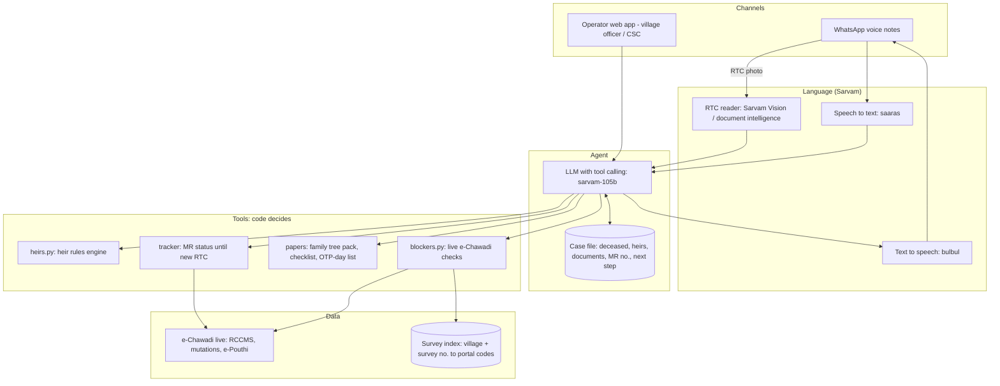

# Pauti Mitra

A Kannada voice agent that helps families transfer inherited land records.

Tech4Bharat (GAVS 2026), Theme 1: Real Estate and Land, problem 1.2: land records too unclear to sell, inherit or borrow against.

## The problem in one line

About 48 lakh land records (RTCs) in Karnataka still list an owner who has died. Until the record moves to the heirs, the family can't sell the land, divide it, get a loan against it or claim schemes tied to land.

## What Pauti Mitra does

It gets a family ready for Karnataka's own inheritance process (pouthi khata / e-Pouthi), so the application goes through on the first try. How that process works, with sources: [docs/karnataka-system.md](docs/karnataka-system.md).

0. **It goes to the family first.** Village officers have already flagged about 48 lakh dead owners during Aadhaar seeding. The village officer or service-centre operator works through their village's list with Pauti Mitra.
1. **It talks** to the family in Kannada: who died, who is alive, any will, dispute or earlier partition.
2. **It reads the RTC photo:** owners (column 9, where "ಲೇ" marks the late), mutation history (column 10, earlier ಪೌತಿ), loans and court stays (column 11).
3. **It works out the heirs and shares** with tested rules (Hindu Succession Act, daughters equal). **A daughter giving up her share confirms it on her own.**
4. **It checks for blockers live:** pending revenue court case, a transfer already in progress, an e-Pouthi already filed.
5. **It prepares the papers:**
   - the family tree certificate pack (drawn tree, affidavit draft, every heir listed);
   - the document checklist;
   - an "Aadhaar OTP day" list, so every heir has a linked, working mobile.
6. **It tracks the MR number** on e-Chawadi until the new RTC is out.

All heirs go onto the RTC jointly first. Dividing the land (partition, 11E sketch, podi) is a separate step later, which is Karnataka's own order, so a family doesn't have to agree on the split to start.

The LLM asks and explains. Who inherits, and what blocks the transfer, is decided by code and live data.

## Architecture

| Layer | Component | Does | State |
|---|---|---|---|
| Channels | WhatsApp bot | Voice notes and an RTC photo in, spoken Kannada replies and PDFs out | planned |
| | Operator web app | The village officer or CSC operator runs a case for a family, one village list at a time | planned |
| Language | Sarvam `saaras` | Kannada speech to text | key verified (`sarvam_check.py`) |
| | Sarvam `bulbul` | Kannada text to speech | planned |
| | Sarvam Vision | Reads RTC columns 9, 10, 11 into structured fields, cross-checked against the survey index | next |
| Agent | `sarvam-105b` with tools | Asks one question at a time, fills the case file, calls the tools, explains results. Never decides who inherits | planned |
| Tools | [`engine/heirs.py`](engine/heirs.py) | Class I heirs and shares (male owner: s.8, s.10; female owner: s.15(1)(a), s.16). Wills, ancestral property, disputes, other personal laws go to the revenue office | **built, 7 tests** |
| | [`engine/blockers.py`](engine/blockers.py) | Live: pending RCCMS case, mutation in progress, e-Pouthi already filed. A failed lookup is `unknown`, never green | **built, live** |
| | Papers | Family tree drawing and affidavit draft, checklist, OTP-day list | planned |
| | Tracker | MR number on e-Chawadi until the new RTC | planned (reuses `blockers.py`) |
| Data | e-Chawadi | Public revenue portal. Since Nov 2026 it returns HTML cards, which we parse | live |
| | Survey index | About 9M survey numbers mapped to portal codes, from the author's cadastral crawl. **Not in this repo** (set `PAUTI_DB`) | local |

**Trust and privacy rules (enforced in code):**
- **The LLM never decides heirs or blockers.** It only explains what `heirs.py` and `blockers.py` return, and each claim cites its source.
- **Unclear cases are never guessed.** Wills, disputes, ancestral property and law gaps raise `NeedsReview` and go to the revenue office.
- **e-Pouthi records contain heirs' Aadhaar and mobile numbers.** We report only whether a record exists, and never read those fields out.
- **We store as little as possible.** Lookups need consent. Nothing is kept after the application, and government data isn't redistributed.

## Key research

The references that shape the design most. Full list in [docs/research.md](docs/research.md); other countries in [docs/global-approaches.md](docs/global-approaches.md).

| Reference | Finding | What it means for us |
|---|---|---|
| Karnataka Revenue Department, via [Deccan Herald](https://www.deccanherald.com/india/karnataka/karnataka-has-29-lakh-lands-in-the-name-of-dead-people-3244098), [Hans India](https://www.thehansindia.com/karnataka/govt-launches-special-campaign-to-transfer-land-records-to-heirs-942796) | About 48 lakh RTCs still in dead owners' names; families stall on fees, disputes, unclear heirs, documents | The problem we solve |
| [PRS, Land Records and Titles in India](https://prsindia.org/policy/analytical-reports/land-records-and-titles-india) | 86% of records computerised, only 47% of mutations | The gap is updating records, not storing them |
| [Deininger, Goyal, Nagarajan, J. Human Resources (2013)](https://openknowledge.worldbank.org/server/api/core/bitstreams/9dc8882f-5fbf-5df5-9aca-78a67f413fa4/content) | Karnataka's equal-share reform raised daughters' land inheritance by 22 points, but bias remained | Daughters' shares enforced by rules |
| [Roy, J. Development Economics (2015)](https://ideas.repec.org/a/eee/deveco/v114y2015icp233-251.html) | Families worked around the reform by giving land to sons | Every share shown openly; a daughter giving up hers needs her own consent |
| [NCAER, land as collateral](https://ncaer.org/?p=14819) and [EAC-PM, SVAMITVA (2026)](https://eacpm.gov.in/wp-content/uploads/2026/04/Unlocking-property-rights-through-SVAMITVA-Fin-rev.pdf) | Clear title opens formal credit, including for women and poorer households | Impact, and lenders as paying customers |
| [Medhi, Sagar, Toyama, Text-Free UIs, ITID (2007)](https://courses.cs.washington.edu/courses/cse490c/18au/readings/medhi-2007.pdf) and [Patel et al., Avaaj Otalo, CHI (2010)](https://collablab.northwestern.edu/CollabolabDistro/nucmc/PatelEtAl-AvaajOtalo-VoiceForumForSmallFarmers-2010.pdf) | Low-literacy users prefer voice; a phone voice service worked for 51 farmers over 7 months | Voice-first, no text in the family's flow |
| [Merigoux et al., Catala, ICFP (2021)](https://arxiv.org/abs/2103.03198) | Law written as testable code, paragraph by paragraph; found a bug in an official implementation | Heir rules as tested code, not an LLM guess |
| Japan, mandatory inheritance registration (2024): [Hiroshima City](https://www.city.hiroshima.lg.jp/english/paperwork/1029827/1009917.html), [Real Estate Tokyo](https://www.realestate-tokyo.com/news/inheritance-registration-mandatory) | Unregistered inheritances left land with unknown owners larger than Kyushu; Japan now requires registration within 3 years (fine up to 100,000 yen) | Same problem, solved by law plus a simple heir filing; we make the filing easy |
| [Rwanda Land Tenure Regularization, World Bank](https://openknowledge.worldbank.org/server/api/core/bitstreams/d63797f6-e70f-54b9-8dd8-6ab36c658793/content) | 8.4 million parcels registered in 3 years, but later transfers stayed unregistered | A one-time drive isn't enough; updating must stay cheap and local |
| US heirs' property: [Union of Concerned Scientists](https://ucsusa.org/resources/lost-inheritance), [Cambridge](https://www.cambridge.org/core/product/D90A1CBE535C040CFF2A267423FE3A0F) | Unresolved inheritance is a leading cause of Black farmland loss; 21 states adopted a law to protect heirs | Unclear heirs cost land; settle them early |

## Repo

| Folder | What's inside |
|---|---|
| [docs/problem.md](docs/problem.md) | The problem, with numbers and sources |
| [docs/research.md](docs/research.md) | Papers and reports we used |
| [docs/global-approaches.md](docs/global-approaches.md) | How Japan, the US, China, Estonia, Rwanda and Ethiopia handle it, and the best approach combined |
| [docs/existing-tech.md](docs/existing-tech.md) | What already exists (Landeed, the government campaign, open models) and what we reuse |
| [docs/karnataka-system.md](docs/karnataka-system.md) | How pouthi / e-Pouthi, RTC columns, mutation, RCCMS and podi actually work, and what that changes in our design |
| [docs/design.md](docs/design.md) | Workflow and stack |
| [docs/gaps-and-plan.md](docs/gaps-and-plan.md) | Open gaps, how we close them, build plan, risks |
| [engine/](engine/) | Heir rules engine (`heirs.py`, tested) and live blocker check (`blockers.py`) |
| [tools/make_rtcs.py](tools/make_rtcs.py) | Makes labelled synthetic RTC photos (real IIHS/DoLR layout, made-up names) to score the RTC reader |
| `sarvam_check.py` | One Sarvam call to check the API key (key in `.env`, never committed) |
| [deck/](deck/) | Idea submission deck (PDF + HTML source) |

## Status

Shortlisted for the Tech4Bharat 2026 prototype round. Building now.

| Part | State |
|---|---|
| Heir rules engine | built, 7 tests (`python3 engine/test_heirs.py`) |
| Blocker check (pending cases, mutations, e-Pouthi) | built, live against e-Chawadi; needs the survey index (`PAUTI_DB`), not in this repo |
| Sarvam API | key verified |
| RTC reader, agent, papers, Kannada voice, WhatsApp | not started |
