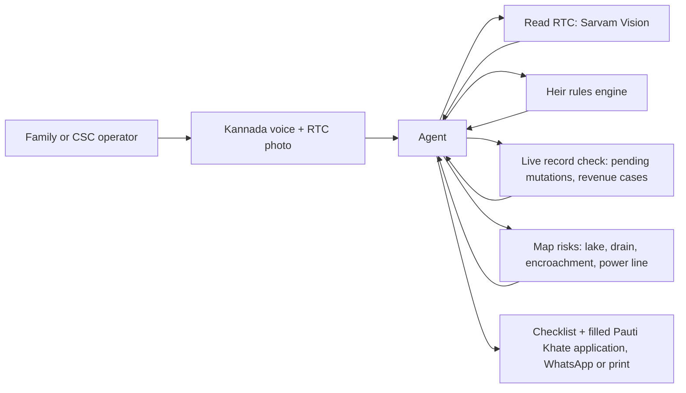

# Design

## Workflow

1. **Talk:** survey number, who died, who is alive (spouse, sons, daughters, children of a child who died), any partition or will. One question at a time.
2. **Read:** Sarvam Vision reads owners, extent and survey number from the RTC photo. These are cross-checked against cadastral data; anything that doesn't match is asked back.
3. **Heirs:** a rules engine applies the Hindu Succession Act (as amended in 2005, daughters equal), other personal laws as separate rule sets. Output: each heir and share, explained in Kannada.
4. **Blockers:** pending mutations and revenue cases for the survey number, plus map overlaps. Each one comes with the office to visit and what to bring.
5. **Hand over:** checklist and pre-filled application, sent on WhatsApp or printed at the service centre.

Unusual cases (a will, a dispute, a court case) are flagged and sent to the revenue office. The agent never guesses them.

## Stack

| Layer | Pieces |
|---|---|
| Channels | WhatsApp bot, service centre operator web app, printable PDF |
| Language | IndicConformer (Kannada speech to text), Jugalbandi-style voice flow, Sarvam Vision (RTC only) |
| Agent | LLM with tool calling, case file (who died, heirs, documents, next step) |
| Tools | heir rules engine (Python, tested), record checks, map overlays, form filler |
| Data | cadastral base (~29,900 villages, ~90 lakh survey rows), overlay layers from public maps |

## Business model

Free for families. Banks, NBFCs and cooperatives pay per land report before a loan; service centres pay per completed application.
